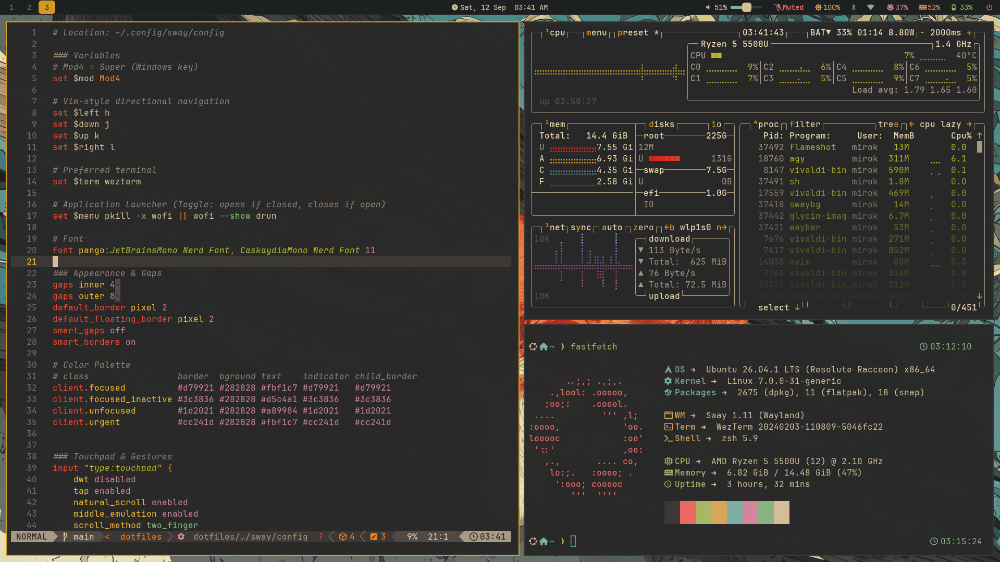
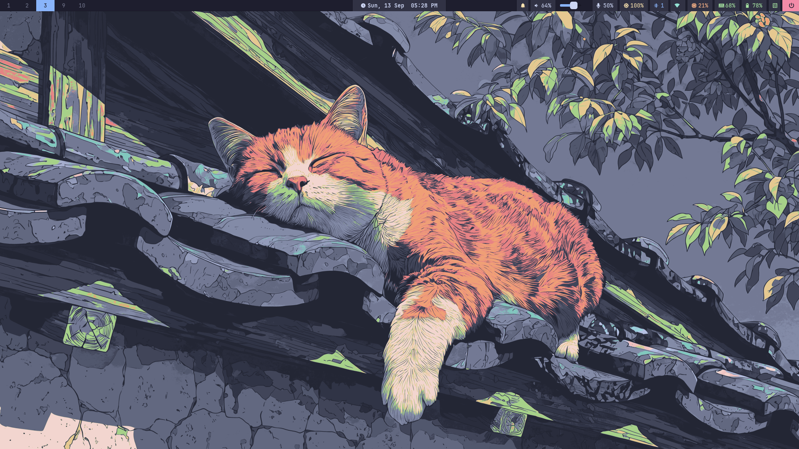

# dotfiles

> *After six years of exploring Linux, I finally have a workspace I can proudly call my own. These are the configurations that make it happen.*



<details>
  <summary>Clean Desktop</summary>
  <br>
  
</details>

Personal configuration files for a Linux development environment and Sway (Wayland) desktop, managed with [GNU Stow](https://www.gnu.org/software/stow/).

Much of this desktop's workflow and visual direction comes from
[Omarchy](https://omarchy.org/), created by
[David Heinemeier Hansson (DHH)](https://dhh.dk/) and developed with the Omarchy
community. The bundled `omarchy-*` themes, wallpapers, and previews come from
that project, with local adaptations for Sway and the applications configured
here. See [Credits and attribution](#credits-and-attribution) for the sources
and preserved license notices.

## Contents

| Package | Description |
| :--- | :--- |
| `bash` | Bash shell configuration (`.bashrc`) |
| `zsh` | Zsh configuration and Starship prompt (`.zshrc`) |
| `git` | Git global configuration and aliases (`.gitconfig`) |
| `nvim` | Neovim configuration built on [LazyVim](https://www.lazyvim.org/) |
| `alacritty` | Alacritty terminal emulator configuration |
| `kitty` | Kitty terminal emulator configuration and theme-switching support |
| `wezterm` | WezTerm terminal emulator configuration (GPU-accelerated, Zellij integration, slim tiling padding) |
| `tmux` | Tmux terminal multiplexer configuration |
| `zellij` | Zellij terminal multiplexer configuration and themes |
| `sway` | Sway Wayland tiling window manager (Omarchy-inspired dynamic tiling) |
| `waybar` | Waybar status bar configuration (fully themeable via `theme-switch`) |
| `quickshell` | Omarchy-style theme and wallpaper carousel, including automatic preset matching |
| `wofi` | Wofi Wayland application launcher and power menu styling |
| `swaync` | SwayNotificationCenter styling and configuration (with system audio alerts) |
| `hyprlock` | Hyprlock fast Wayland screen locker configuration |
| `btop` | btop++ system monitor configuration and themes |
| `fastfetch` | Fastfetch system information configuration |
| `lazygit` | Lazygit terminal UI configuration |
| `lazydocker` | Lazydocker terminal UI configuration |
| `mise` | mise-en-place dev environment tool configuration |
| `yazi` | Yazi terminal file manager configuration and theme-switching support |
| `bin` | Custom CLI utilities including `theme-switch`, `theme-picker`, `sway-lock`, `sway-autotile`, `sway-powermenu`, `sway-wallpaper`, `sway-maximize`, `wallpaper-preview`, and `brightness-step` |

## Desktop Environment (Sway & Wayland)

The graphical environment is built on [Sway](https://swaywm.org/) with an Omarchy-inspired workflow:

- **Dynamic Tiling (`sway-autotile`)**: A background IPC daemon that automatically alternates horizontal and vertical window splits based on the active container's aspect ratio, providing a seamless dwindle-style tiling experience (similar to Hyprland / Omarchy).
- **Status Bar ([Waybar](https://github.com/Alexays/Waybar))**: Top status bar displaying active workspaces, window title, CPU, memory, battery, audio, network applet, clock, and an interactive power button.
- **Application Launcher ([Wofi](https://hg.sr.ht/~scoopta/wofi))**: Fast Wayland menu for launching desktop applications (`Super + Space` or `Super + d`).
- **Screen Locker ([Hyprlock](https://github.com/hyprwm/hyprlock))**: Wayland screen locker displaying the time, date, and password prompt (`Super + Escape` or automatic idle lock via `swayidle`). The `sway-lock` launcher returns after lock confirmation, so later idle actions can run while the screen stays locked. It uses swaylock if Hyprlock is unavailable, fails to start, or crashes.
- **Power Menu (`sway-powermenu`)**: Wofi-powered dialog for lock, suspend, logout, reboot, and poweroff (`Super + BackSpace`).
- **Wallpaper Daemon (`sway-wallpaper`)**: Automatically sets and updates the desktop wallpaper with `swaybg`, integrating directly with the active theme selected by `theme-switch`.
- **Theme and Wallpaper Picker ([Quickshell](https://quickshell.org/))**: An on-demand carousel adapted from Omarchy's image picker. Browse themes, change the current theme's wallpaper, or use `theme browse` to select a wallpaper and apply its matching preset.
- **File Explorers**:
  - **TUI (Terminal)**: [Yazi](https://yazi-rs.github.io/) bound directly to `Super + Shift + Return`.
  - **GUI**: **GNOME Files (`nautilus`)** configured as the default directory handler (`inode/directory`), accessible via launcher or running `nautilus` / `xdg-open .`.

### Keybindings Reference

| Keybinding | Action |
| :--- | :--- |
| `Super + Return` | Open terminal (`kitty`) |
| `Super + Space` or `Super + d` | Application launcher (`wofi`) |
| `Super + Shift + Return` | Terminal file manager (`yazi`) |
| `Super + b` | Open default web browser |
| `Super + q` or `Super + Shift + q` | Close / kill focused window |
| `Super + h / j / k / l` (or Arrows) | Move focus (left, down, up, right) |
| `Super + Shift + h / j / k / l` (or Arrows) | Move focused window container |
| `Super + 1 .. 0` | Switch to workspace 1..10 |
| `Super + Shift + 1 .. 0` | Move focused container to workspace 1..10 |
| `Super + f` | Toggle true fullscreen mode |
| `Super + m` | Toggle pseudo-maximize (fill workspace under Waybar) |
| `Super + Shift + Space` | Toggle floating mode |
| `Super + e` / `s` | Layout toggle (split / stacking) |
| `Super + -` / `Super + Shift + -` | Scratchpad show / move container to scratchpad |
| `Super + r` | Enter window resize mode (`hjkl` / arrows to resize, `Enter` or `Esc` to exit) |
| `Super + Escape` | Lock screen (`hyprlock`) |
| `Super + BackSpace` | Power menu (`sway-powermenu`) |
| `Super + Shift + s` | Screenshot (`flameshot`) |
| `Super + Shift + r` | Reload Sway configuration |
| `Super + Shift + e` | Prompt to exit Sway session |
| `Super + v` | Clipboard history picker (`cliphist` + `wofi`) |
| `Super + Shift + d` | Display manager (`nwg-displays`) |
| `Super + Shift + n` | Toggle notification panel (`swaync`) |
| `Super + Ctrl + Shift + Space` | Open the theme gallery |
| `Super + Ctrl + Space` | Open the current theme's wallpaper gallery |

## Ecosystem & Android Integration

To achieve a seamless "Apple-like" ecosystem between the Linux desktop and Android devices, this setup utilizes:

- **KDE Connect** (or **Valent**): Connects your Android phone to the desktop. Notifications are piped directly into `swaync`, the clipboard is synchronized, and media controls map to Waybar.
- **System Tray**: The `kdeconnect-indicator` runs in the Waybar system tray for quick access to battery stats and device settings.
- **Audio Alerts**: Custom `paplay` sound triggers are configured in `swaync` to play an audio chime when notifications (like phone calls or text messages) arrive.
- **LocalSend & Scrcpy** (Recommended Extended Tools): Use LocalSend for instant AirDrop-like file transfers, and Scrcpy for low-latency screen mirroring and remote control of your phone.

## Theme Switcher

A unified, distro-agnostic theme switcher is included and symlinked to `~/.local/bin/theme-switch` (aliased as `theme`).

Run the interactive menu:

```sh
theme
```

In a graphical session with [Quickshell](https://quickshell.org/) installed,
this opens an Omarchy-style carousel: a large angled preview in the centre,
narrow image slices on each side, and the selected name underneath. Select
an image, then press Enter or click the centre preview or Apply. The gallery
stays open so you can compare selections; Escape or Close
exits the picker process. It does not run a background service.

Use Themes, Wallpapers, or All wallpapers (`Ctrl+1`, `Ctrl+2`, or `Ctrl+3`) to switch views.
Left / Right or Tab / Shift+Tab browse the carousel; type to filter, and use
`Ctrl+F` to focus search. On Sway, the gallery
opens on your focused monitor. The existing theme-switching script applies
the colours and remembers each theme's selected wallpaper.

For a wallpaper-first workflow, open **All wallpapers** or run:

```sh
theme browse
# alias: theme all-wallpapers
```

This shows wallpapers grouped by preset and displays each image's matching
theme. **Apply wallpaper + theme** applies that preset with the exact selected
image; if its preset is already active, it changes only the wallpaper.
The gallery stays open for comparison. Filter by wallpaper or theme name.
The existing Wallpapers view continues to change only the current theme's
wallpaper. Use `theme --cli browse` for the terminal version.

Set `THEME_PICKER_REDUCED_MOTION=1` to disable the brief carousel transitions.

The terminal picker remains available when Quickshell is missing or there is
no graphical session. You can also choose the interface explicitly:

```sh
theme --cli
theme --cli wallpaper
theme --gui
```

Install Quickshell using the [dependency instructions](dependencies.md), then
run `stow --dotfiles -R --target "$HOME" bin quickshell` from the repo root
to link the new picker files. The Sway shortcuts are `Super+Ctrl+Shift+Space`
for themes and `Super+Ctrl+Space` for wallpapers.

Or specify a theme directly:

```sh
theme gruvbox
theme catppuccin-mocha
theme tokyo-night
```

The switcher simultaneously updates:

- Terminal emulators (Alacritty, WezTerm, Kitty)
- Terminal multiplexers (Zellij, Tmux — reloads live if running)
- Neovim colorscheme
- Waybar, Wofi, and SwayNC styling
- btop++ system monitor
- Yazi file manager
- Screen locker colors (Hyprlock)
- Desktop wallpaper and accent color (supports Sway via `swaybg`, Hyprland, GNOME, and X11)

Available themes: `catppuccin`, `catppuccin-latte`, `catppuccin-frappe`, `catppuccin-macchiato`, `catppuccin-mocha`, `coolnight` (Original colorscheme by Josean Martinez), `everforest`, `gruvbox`, `kanagawa`, `matte-black`, `nord`, `osaka-jade`, `ristretto`, `rose-pine`, `solarized-dark`, `tokyo-night`, plus the 22 `omarchy-*` themes below.

### Catppuccin Flavours

All four [official Catppuccin palettes](https://catppuccin.com/palette/) are
available as separate themes, with matching colours across all supported apps:

| Theme | Appearance | Base colour |
| --- | --- | --- |
| `catppuccin-latte` | Light | `#eff1f5` |
| `catppuccin-frappe` | Muted dark | `#303446` |
| `catppuccin-macchiato` | Medium dark | `#24273a` |
| `catppuccin-mocha` | Deep dark | `#1e1e2e` |

Each includes five original 4K wallpapers: mountains, dunes, waves, orbits,
and geometric tiles, rendered in that flavour's palette. Switching to Latte
also selects the light desktop preference; the other flavours select dark.
The existing `catppuccin` entry retains its previous configuration.

The four flavours and the original `catppuccin` theme also include **36 unique
wallpapers from [CozyPixels](https://github.com/SleepyCatHey/CozyPixels)**:
Characters & People, Pixel Art, and Seasonal & Weather. Open `theme wallpaper`
and filter by `cozypixels` to browse them. Duplicate images appear once per
theme, and the animated GIF is available as a still PNG for Sway. Sources,
checksums, and credits are recorded in [the collection documentation](assets/cozypixels/README.md).

```sh
theme catppuccin-latte
theme wallpaper
```

The theme picker discovers these directories automatically; no reinstall or
Stow update is needed. Wallpaper sources and regeneration instructions are in
[`assets/catppuccin/`](assets/catppuccin/README.md).

### Omarchy Collection

The **22 stock themes and 92 wallpapers** in this collection are imported from
[Omarchy v4.0.6](https://github.com/omacom/omarchy/releases/tag/v4.0.6).
Credit goes to **DHH, the Omarchy contributors, and the original theme designers
and wallpaper artists** whose work the project brings together.

They are available as separate `omarchy-*` entries. Type `omarchy` in the theme
picker to browse the collection. Omarchy's original theme previews appear in
the carousel, and Wallpapers lists every background bundled with the selected
theme. The existing custom themes remain separate.

```sh
theme omarchy-ethereal
theme omarchy-retro-82
theme omarchy-flexoki-light
theme wallpaper
```

All supported apps have matching configs. Imported light themes also select
the light desktop preference. Neovim retains upstream plugin specifications
with a palette fallback for plugins that are not installed yet.

See the [collection inventory and provenance](assets/omarchy/README.md) for
theme names, wallpaper counts, the pinned source commit, and import details.

### Multiple Wallpapers Per Theme

Each theme can have a `wallpapers/` subdirectory with multiple images. To interactively select a wallpaper for the current theme:

```sh
theme wallpaper
# or
theme -w
```

Quickshell displays a large selection preview surrounded by neighbouring images. With the
terminal picker (`theme --cli wallpaper`), `fzf` shows a live preview through
`chafa` (`sudo apt install chafa`). Optional ImageMagick thumbnails are cached
in `~/.cache/dotfiles/theme-picker/` and regenerated when source images change.

## Requirements

- **Core**: Git, [GNU Stow](https://www.gnu.org/software/stow/), Zsh, Python 3, Neovim, Tmux, curl, wget, ripgrep, fzf
- **Desktop (Sway / Wayland)**: Sway, Waybar, SwayNC, Wofi, Hyprlock, swaybg, swayidle, grim, slurp, wl-clipboard, brightnessctl, playerctl, nautilus, pavucontrol, blueman, cliphist, nwg-displays, kanshi, power-profiles-daemon, JetBrainsMono Nerd Font
- **Lock launcher**: Python 3 and coreutils (`stdbuf`), with Hyprlock 0.9.6 or swaylock. A small supervisor runs only while locked; concurrent requests share it. Hyprlock readiness uses its compositor-confirmation message; swaylock uses its readiness file descriptor. Startup attempts are bounded, and failure to confirm either locker returns an error.

For a complete breakdown of what each dependency is used for, as well as optional/extended tools (like WezTerm, Zellij, and Yazi), see the **[Dependencies List](dependencies.md)**.

## Installation

Clone the repository to your home directory:

```sh
git clone git@github.com:SabidMahmud/dotfiles.git ~/dotfiles
```

Run the bootstrap script to install packages and apply all symlinks:

```sh
cd ~/dotfiles
bash install.sh
```

*(Pass `--desktop` if running from a TTY or headless setup where auto-detection is not present: `bash install.sh --desktop`)*

The script will:

1. Detect your package manager (`apt`, `pacman`, or `dnf`) and install core dependencies (plus desktop packages if a graphical session or `--desktop` is detected).
2. Symlink all configurations into your home directory via `stow --dotfiles`.
3. Ensure custom executable scripts in `~/.local/bin/` have executable permissions.
4. Install Starship prompt, Zoxide, and Zsh plugins (`zsh-autosuggestions`, `zsh-syntax-highlighting`).
5. Set Zsh as your default shell if it is not already.
6. Remind you to create `~/.zshrc.local` for machine-specific secrets.

### After Installation

Install any recommended extended tools if not already present on your distro:

```sh
# Terminal & multiplexers (examples for apt)
# https://wezfurlong.org/wezterm/installation.html
# https://zellij.dev/documentation/installation.html

# Terminal file manager & monitor
# https://yazi-rs.github.io/docs/installation
sudo apt install btop
```

Apply your preferred theme:

```sh
theme gruvbox
```

## Machine-local Configuration

Secrets, API keys, and anything machine-specific must never be committed. The `~/.zshrc` sources `~/.zshrc.local` if it exists. Create this file on each machine after installation:

```sh
cat << 'LOCALEOF' > ~/.zshrc.local
export SOME_API_KEY="your-key-here"
export ANOTHER_SECRET="value"
LOCALEOF
```

This file is listed in `.gitignore` and will never be tracked.

## Structure

Stow's `--dotfiles` flag is used throughout this repository. Files and folders prefixed with `dot-` in the repo are mapped to their `.`-prefixed equivalents in the home directory at symlink time. This keeps all files visible in editors and file browsers without needing to toggle hidden file display.

```
dotfiles/
├── sway/
│   └── dot-config/sway/
│       └── config             # symlinked to → ~/.config/sway/config
├── waybar/
│   └── dot-config/waybar/
│       ├── config.jsonc       # symlinked to → ~/.config/waybar/config.jsonc
│       └── style.css          # symlinked to → ~/.config/waybar/style.css
├── quickshell/
│   └── dot-config/quickshell/theme-picker/
│       └── shell.qml          # on-demand theme and wallpaper carousel
├── wofi/
│   └── dot-config/wofi/
│       ├── config             # symlinked to → ~/.config/wofi/config
│       └── style.css          # symlinked to → ~/.config/wofi/style.css
├── hyprlock/
│   └── dot-config/hypr/
│       └── hyprlock.conf      # symlinked to → ~/.config/hypr/hyprlock.conf
├── bin/
│   └── dot-local/bin/
│       ├── theme-switch       # symlinked to → ~/.local/bin/theme-switch
│       ├── theme-picker       # Quickshell launcher and preset/wallpaper backend
│       ├── sway-lock          # symlinked to → ~/.local/bin/sway-lock
│       ├── sway-autotile      # symlinked to → ~/.local/bin/sway-autotile
│       ├── sway-maximize      # symlinked to → ~/.local/bin/sway-maximize
│       ├── sway-powermenu     # symlinked to → ~/.local/bin/sway-powermenu
│       ├── sway-wallpaper     # symlinked to → ~/.local/bin/sway-wallpaper
│       ├── wallpaper-preview  # symlinked to → ~/.local/bin/wallpaper-preview
│       └── brightness-step    # symlinked to → ~/.local/bin/brightness-step
├── nvim/
│   └── dot-config/nvim/       # symlinked to → ~/.config/nvim/
├── zsh/
│   ├── dot-zshrc              # symlinked to → ~/.zshrc
├── tmux/
│   └── dot-config/tmux/
│       ├── tmux.conf          # symlinked to → ~/.config/tmux/tmux.conf
│       └── theme.conf         # auto-managed by theme-switch
├── wezterm/
│   └── dot-config/wezterm/
│       └── wezterm.lua        # symlinked to → ~/.config/wezterm/wezterm.lua
└── themes/
    └── gruvbox/               # NOT stowed — read directly by theme-switch
        ├── alacritty.toml
        ├── wezterm.lua
        ├── tmux.conf
        └── wallpapers/
```

## Credits and attribution

- **[Omarchy](https://github.com/omacom/omarchy), created by [DHH](https://dhh.dk/), and its contributors:** the upstream source for the imported `omarchy-*` themes, colour palettes, wallpapers, previews, and theme assets. This repository adapts that collection to its Sway desktop. The [collection documentation](assets/omarchy/README.md) records the release and pinned commit; the [import manifest](assets/omarchy/manifest.json) maps every imported file to its upstream path and checksum.
- **[Omarchy's Quickshell image picker](https://github.com/omacom/omarchy/blob/84b3f2872b5023c13967543ed4a98b08fcac5b21/shell/plugins/image-picker/ImagePicker.qml):** the source of the angled carousel layout, overlapping previews, and image-mask treatment adapted for this repository's picker. Its [upstream copyright and MIT notice](quickshell/dot-config/quickshell/theme-picker/OMARCHY-LICENSE) are preserved alongside the implementation.
- **[Catppuccin](https://catppuccin.com/) and its community:** the four official palettes used by the separately named Latte, Frappé, Macchiato, and Mocha themes. Their [palette source and license](assets/catppuccin/README.md) are documented separately. The additional geometric wallpapers for those four variants were generated for this repository.
- **[CozyPixels](https://github.com/SleepyCatHey/CozyPixels), curated by [SleepyCatHey](https://github.com/SleepyCatHey), and the original wallpaper artists:** the additional Catppuccin wallpapers from Characters & People, Pixel Art, and Seasonal & Weather. The [collection documentation](assets/cozypixels/README.md) records the pinned source, deduplication, GIF conversion, and preserved license notice. CozyPixels notes that some original artist credits are unknown; this repository claims no authorship of the imported artwork.

Individual theme designs and wallpaper artwork remain the work of their
original creators. Omarchy is credited as the upstream project and curator of
the imported collection. The local work here covers app-specific adaptations,
Stow integration, theme-switching utilities, and wallpaper-to-preset matching.

## License

This repository's own configurations and utilities are MIT-licensed.
Third-party code, themes, palettes, and artwork retain their respective
copyrights and license terms. Preserved upstream notices are available for
[the Omarchy collection](assets/omarchy/LICENSE),
[the adapted Omarchy carousel](quickshell/dot-config/quickshell/theme-picker/OMARCHY-LICENSE),
[the Catppuccin palettes](assets/catppuccin/LICENSE),
and [the CozyPixels collection](assets/cozypixels/LICENSE).
